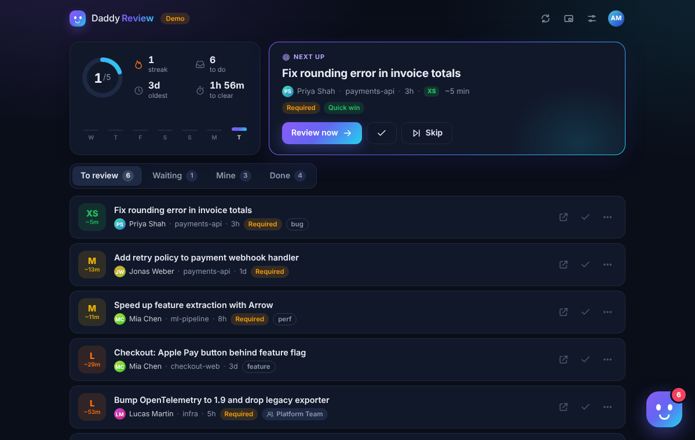
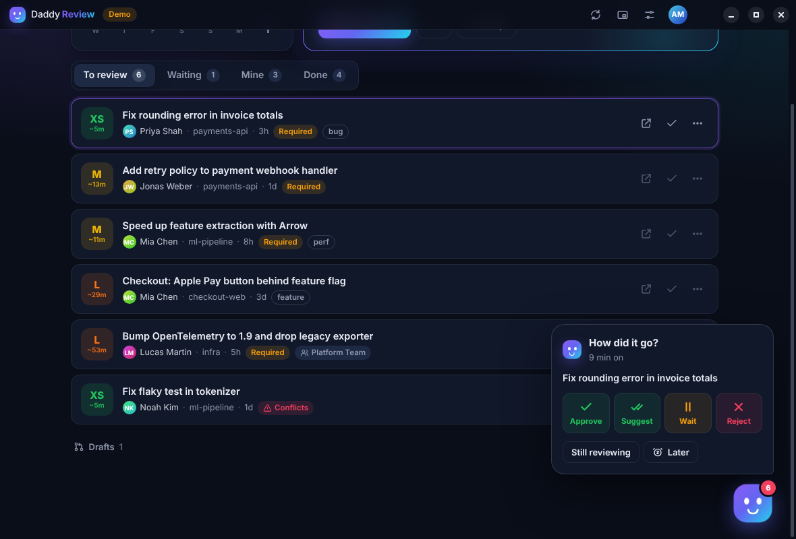
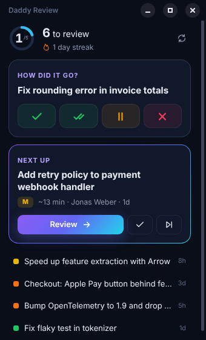

# Daddy Review

A desktop app that helps you do more pull request reviews on **Azure DevOps**. It shows what's waiting for you, picks the best one to do next, pops up when something new arrives and keeps you going with a daily goal and streak.

**Install it like any other app. No PAT, no server, no setup.** Sign in with your Microsoft work account and it finds your organizations on its own.



## Install

**[⬇ Download the latest release](https://github.com/RobinMechele/Daddy-Review/releases/latest)**

- **Windows:** `Daddy-Review-Setup-x.y.z.exe`. Run it; it installs for your user (no admin) and starts.
- **macOS:** `Daddy-Review-x.y.z-arm64.dmg`
- **Linux:** `Daddy-Review-x.y.z.AppImage`

> The installer isn't code-signed yet. Windows may show *"Windows protected your PC"*: click **More info → Run anyway**. On macOS, right-click the app → **Open** the first time.

Then click **Sign in with Microsoft**: your browser opens, you pick your work account, and you're done. If you've used `az login` on this PC, it signs you in by itself. A personal Microsoft account works too (*Personal Microsoft account?* under the button).

**Updates install themselves**: Daddy Review checks GitHub Releases every few hours, downloads new versions in the background and shows *Update ready*. Restart when it suits you, or it installs the next time the app quits. (macOS: it tells you a new version is out.)

## What it does

| | |
|---|---|
| **Next up** | Ranks your queue: required reviews, quick wins (few files), PRs updated since your vote and long-waiting ones go first. Shows size (XS–XL) and an estimated review time. |
| **One-click votes** | Approve, approve with suggestions, wait for author, reject or snooze right from the list. Every vote has *Undo*. |
| **Review in the app** | *Review now* opens the PR right in Daddy Review: every changed file with its diff, comments shown on their lines, comment on any line (+), reply, resolve, mark files as viewed and vote. *Next PR* takes you to the next one. Prefer Azure DevOps? Switch off *Review inside the app* in Settings: then it opens in your browser and the assistant asks how it went when you're back. |
| **Popups** | Windows notifications for new review requests, drafts that are ready for review, new pushes after your review, votes and comments on *your* PRs, a nudge when PRs wait too long and a Friday recap. Click one to open the PR. Optionally only during work hours. |
| **Comments on your PRs** | Your own PRs show which comment threads are waiting for your answer. |
| **Search** | Press `/` and type: title, repo, author, branch or label. |
| **Shortcut** | `Ctrl+Alt+R` shows or hides Daddy Review from anywhere. |
| **Lives in the tray** | Closing the window keeps it watching in the background; the taskbar shows how many PRs are waiting. Starts with Windows (switch off in Settings or the tray menu). |
| **Mini window** | ⧉ opens a small always-on-top window with your next PR, so reviews stay in sight while you work. |
| **All orgs, teams too** | Finds all your Azure DevOps organizations and includes PRs assigned to your teams, also when you're in a team through a group. |
| **Others** | Open PRs that don't ask for you (yet). *+* adds you as a reviewer, so it moves to *To review*. |
| **Your repositories** | Settings → *All repositories*: pick repositories or whole projects; *Others* then only shows PRs from those, and new PRs there pop up. *Only these* hides PRs from other repositories everywhere. |
| **Goal & streak** | Daily review goal, 7-day chart and a workday streak (weekends never break it). |

<p>
  
  
</p>

**Keyboard:** `/` search · `J`/`K` move · `Enter` details · `O` open · `A` approve · `W` wait · `S` snooze · `N` next · `R` refresh · `P` mini window · `?` all shortcuts.
In a review: `N`/`P` next/previous file · `V` viewed · `A` approve · `O` open in Azure DevOps · `Ctrl+Enter` send comment · `Esc` back.

## Sign-in without a PAT

Daddy Review signs in the same way Git Credential Manager and `az login` do:

- **Microsoft account**: it opens your normal browser at Microsoft's sign-in page (so your company's single sign-on and MFA just work) and listens on a random `localhost` port only until Microsoft sends you back. It uses Microsoft's public Visual Studio client, so there's no app registration and no secret, and it only asks for the Azure DevOps permission.
- **Azure CLI**: if you've run `az login`, it uses `az account get-access-token`, with zero clicks.

Everything stays on your PC: the sign-in is kept in your user profile (`%APPDATA%\Daddy Review`). *Sign out* in Settings deletes it.

## Troubleshooting

- **"No access" for an organization**: it may belong to another Entra tenant where you're a guest. Sign out and sign in with that account, or switch the org off in Settings.
- **My organization is missing**: Settings → Organizations → paste its URL (`https://dev.azure.com/your-org`).
- **A PR is missing**: look under *Others* (open PRs that don't ask for you). If you picked repositories in Settings, only those show there. The log file lists per organization how many PRs were found.
- **No popups**: check Windows *Do not disturb* / notification settings for *Daddy Review*.
- **Quit completely**: right-click the tray icon → *Quit Daddy Review*.
- Log file: `%APPDATA%\Daddy Review\daddy-review.log`.

## Development

Needs Node.js 22+.

```
npm install
npm start          # run the desktop app
npm run demo       # the app against a fake Azure DevOps with live activity
npm test           # engine tests (sign-in, queue, votes, events, ...)
npm run test:app   # drives the real desktop app (on Linux: xvfb-run -a npm run test:app)
npm run dist       # build the installer for this OS into dist/
```

Every push builds the Windows, macOS and Linux installers in GitHub Actions, installs the Windows one and drives it (including a self-update). To publish a release: bump `version` in `package.json`, then **Actions → Build desktop app → Run workflow** with *release* set to e.g. `v1.2.0` (or push that tag). Installed apps pick it up automatically.

```
electron/  main.js (window, tray, notifications, sign-in, autostart, shortcut) · updater.js · preload.js (the UI's only bridge)
server/    core.js (engine API) · auth.js (Microsoft / Azure CLI) · loopback.js (desktop sign-in)
           ado.js (Azure DevOps REST) · inbox.js (polling, events, stats) · logic.js (ranking, diffing)
           review.js (reviewing in the app) · diff.js (line diffs)
           index.js (browser dev mode, used by the tests)
public/    the UI: index.html · styles.css · js/
demo/      fake Azure DevOps + Microsoft sign-in for the demo and the tests
```
